# CIO Loyalty — backend сервиса лояльности

## Простыми словами

Это сервер для мобильного приложения, в котором клиенты брендов копят баллы и меняют их на награды: кофе, десерт, скидку, мерч. Приложение показывает баланс и каталог, а сотрудники бренда в админке добавляют награды и пополняют клиентам баллы.

За баллами следит отдельный журнал операций: если запрос повторится или оборвётся связь, баллы не спишутся дважды. Оплату пакетов баллов принимает ЮKassa, а тесты проверяют, что при нехватке баллов, нулевом остатке и чужом бренде операция не пройдёт.

Собрано на PHP 8.3 и Laravel 12: REST API для мобильного клиента плюс админ-панель на Blade.

Пет-проект под вакансию **PHP-разработчика (Laravel)** в digital-агентстве: серверная часть мобильного приложения
лояльности для брендов — баллы, уровни, каталог наград, покупка пакетов баллов, админ-панель.

Проект специально сделан как «продукт агентства»: несколько брендов на одной кодовой базе, публичное REST API для
мобильного клиента и рабочее место оператора для управления каталогом и балансами.

## Как это выглядит

Демо-сценарий на живом стенде: вход по коду, покупка пакета баллов, обмен награды и повтор запроса с тем же
`Idempotency-Key` — баллы не списываются дважды.

<p align="center">
  
</p>

## Что внутри

| Зона | Реализация |
| --- | --- |
| PHP / Laravel | PHP 8.3+, Laravel 12, строгая типизация (`declare(strict_types=1)`) |
| Архитектура | Тонкие контроллеры → доменные сервисы → модели; DTO, enum'ы, контракты шлюзов |
| REST API | `v1`, ресурсы, form-request валидация, Sanctum-токены, лимиты запросов |
| Мультитенантность | `X-Brand` → `BrandContext` (scoped singleton), проверка принадлежности токена бренду |
| Баллы | Журнал операций (ledger) с блокировкой счёта, идемпотентность по ключу, пересчёт уровня |
| Награды | Каталог с кешем в Redis и точечной инвалидацией, атомарное списание + контроль стока |
| Платежи | Контракт `PaymentGateway`, драйверы `fake` и `yookassa`, вебхук с проверкой IP и идемпотентностью |
| Очереди | Job'ы на Redis: пуши после обмена, еженедельный пересчёт уровней, сгорание баллов по расписанию |
| Админка | Blade + сессионная авторизация, роли `admin`/`manager`, дашборд, CRUD наград, карточка клиента |
| Качество | PHPUnit (unit + feature), Pint, GitHub Actions, OpenAPI-спека |

Документация:

- [`docs/ARCHITECTURE.md`](docs/ARCHITECTURE.md) — схема БД, жизненный цикл запроса, принятые решения и компромиссы.
- [`docs/openapi.yaml`](docs/openapi.yaml) — контракт публичного API.
- [`docs/DEFENSE.md`](docs/DEFENSE.md) — как презентовать проект на собеседовании и что он доказывает по пунктам вакансии.

## Быстрый старт

Нужны PHP 8.3+, Composer, MySQL (или PostgreSQL) и Redis. Поднять инфраструктуру можно через `docker compose up -d mysql redis`.

```bash
composer install
cp .env.example .env
php artisan key:generate

php artisan migrate --seed      # схема + демо-бренд, награды, клиенты
php artisan serve               # http://localhost:8000

php artisan queue:work          # пуши и фоновые задачи
php artisan schedule:work       # сгорание баллов и пересчёт уровней (в проде — cron)
```

Демо-доступ в админку (`/admin/login`) после сидинга: `admin@cio.test` / `password` (глобальный админ)
и `manager@cio.test` / `password` (менеджер бренда `coffee-lab`).

### Запуск на этом компьютере (portable PHP)

В папке проекта уже лежит PHP 8.3 и Composer — `.tools/php/php.exe` и `.tools/composer.phar`, ставить ничего не нужно.
База настроена на SQLite (`database/database.sqlite`), очередь и кеш — на таблицы БД, поэтому Redis не требуется.

- `start.bat` — поднимает сервер на `http://127.0.0.1:8000` и открывает форму входа в админку.
- `test.bat` — запускает все тесты.

Вручную те же команды:

```bat
.tools\php\php.exe artisan test
.tools\php\php.exe artisan migrate --seed
start.bat
```

Порт 8000 занят? Запустите сервер на другом:

```bat
cd public
..\.tools\php\php.exe -S 127.0.0.1:8081 ..\vendor\laravel\framework\src\Illuminate\Foundation\resources\server.php
```


## API за пять минут

Все запросы мобильного клиента идут с заголовком `X-Brand: coffee-lab`.

```bash
# 1. Запросить код (в local/testing возвращается debug_code)
curl -s -X POST http://localhost:8000/api/v1/auth/otp \
  -H 'Content-Type: application/json' -H 'X-Brand: coffee-lab' \
  -d '{"phone":"+79001234567"}'

# 2. Получить токен
curl -s -X POST http://localhost:8000/api/v1/auth/token \
  -H 'Content-Type: application/json' -H 'X-Brand: coffee-lab' \
  -d '{"phone":"+79001234567","code":"000000"}'

# 3. Каталог наград
curl -s http://localhost:8000/api/v1/rewards -H 'X-Brand: coffee-lab'

# 4. Обменять баллы (идемпотентно по ключу)
curl -s -X POST http://localhost:8000/api/v1/rewards/1/redeem \
  -H "Authorization: Bearer $TOKEN" -H 'X-Brand: coffee-lab' \
  -H 'Idempotency-Key: order-42'

# 5. Купить пакет баллов (в local — фиктивный шлюз)
curl -s -X POST http://localhost:8000/api/v1/payments \
  -H "Authorization: Bearer $TOKEN" -H 'Content-Type: application/json' -H 'X-Brand: coffee-lab' \
  -d '{"package":"p1000"}'
```

Вебхук платёжного провайдера: `POST /api/v1/webhooks/payments/yookassa` (проверка источника по списку CIDR
`YOOKASSA_WEBHOOK_IPS`, повторная доставка не начисляет баллы дважды).

## Ключевые технические решения

**Журнал баллов вместо `balance = balance - N`.** Каждая операция — запись в `point_transactions` с
`balance_after` и опциональным `idempotency_key`. Баланс счёта — материализованный кеш журнала, обновляется в той же
транзакции с `lockForUpdate()`. Это даёт аудит, защиту от гонок и безопасные повторы.

**Идемпотентность на уровне домена.** Повторный запрос с тем же `Idempotency-Key` возвращает исходный обмен,
а не списывает баллы ещё раз; для платежей ключом служит идентификатор платежа, поэтому ретраи вебхука безопасны.

**Мультитенантность явная, а не «по умолчанию».** Бренд определяется заголовком `X-Brand`, кладётся в scoped
`BrandContext`, а `EnsureCustomerBrand` не даёт токену одного бренда работать в другом. В админке область видимости
задаётся ролью: `admin` видит все бренды, `manager` — только свой.

**Кеш с точечной инвалидацией.** Каталог наград кешируется по ключу `brand:{id}:rewards:active`; любая запись
через админку сбрасывает именно этот ключ. Без `Cache::tags()`, поэтому работает и на `redis`, и на `database`-сторе.

**Шлюзы за интерфейсами.** `PaymentGateway` и `PushGateway` — контракты; провайдер выбирается в
`AppServiceProvider` по `PAYMENT_DRIVER`. В тестах используется `fake`-драйвер, реальные ключи не нужны.

**Деньги и баллы — разные типы.** Баллы — целые, суммы — `decimal(10,2)`; конвертация сумм в баллы идёт через
конфиг пакетов, а не размазана по коду.

## Структура

```
app/
  Console/Commands/     # loyalty:expire-points
  Enums/                # Tier, PointTransactionType, PaymentStatus, RedemptionStatus, UserRole
  Exceptions/           # DomainException и потомки (HTTP-коды в одном месте)
  Http/
    Controllers/Api/V1  # мобильное API
    Controllers/Admin   # админка (Blade)
    Middleware/         # ResolveBrand, EnsureCustomerBrand, EnsureUserHasRole, EnsureWebhookFromTrustedIp
    Requests/           # валидация входа
    Resources/          # контракт ответов API
  Jobs/                 # SendPushNotification, RecalculateTier
  Models/               # Brand, Customer, LoyaltyAccount, PointTransaction, Reward, Redemption, Payment
  Services/
    Auth/               # OtpService
    Catalog/            # RewardCatalog (кеш)
    Loyalty/            # PointLedger, TierCalculator, RedemptionService
    Notifications/      # PushGateway + LogPushGateway
    Payments/           # PaymentGateway, FakeGateway, YooKassaGateway, PaymentService
  Support/              # BrandContext
database/
  migrations/ factories/ seeders/
docs/
  ARCHITECTURE.md openapi.yaml DEFENSE.md
tests/
  Unit/ Feature/ Feature/Admin/
```

## Тесты и проверки

```bash
php artisan test        # unit + feature, SQLite in-memory
vendor/bin/pint --test  # стиль кода
```

Покрыты критичные сценарии: выпуск токена по OTP, успешный обмен и списание, недостаток баллов, нулевой сток,
чужой бренд, повтор запроса с тем же `Idempotency-Key`, начисление по вебхуку и его повторная доставка,
инвалидация кеша каталога, доступы в админке.

## Ограничения демо-стенда

- OTP не отправляется по SMS: в `local`/`testing` код фиксированный (`000000`) и возвращается в ответе.
- `PAYMENT_DRIVER=fake` создаёт платёж с локальной ссылкой подтверждения; интеграция с ЮKassa реализована,
  но требует боевых ключей и публичного `return_url`.
- Нет Horizon, GraphQL и Elasticsearch — они вынесены в план развития (`docs/ARCHITECTURE.md`), чтобы не тащить
  в пет-проект неиспользуемую инфраструктуру.
