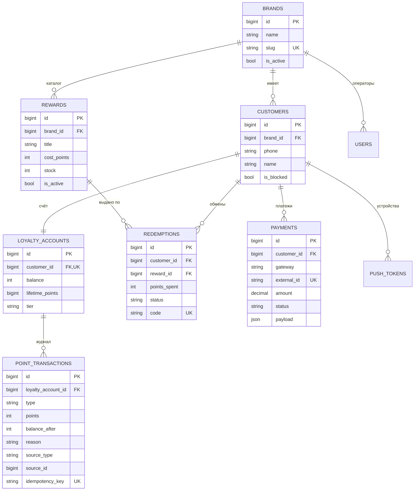
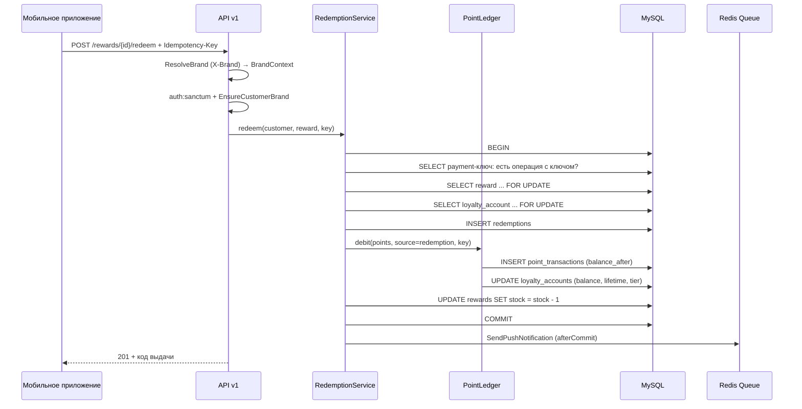
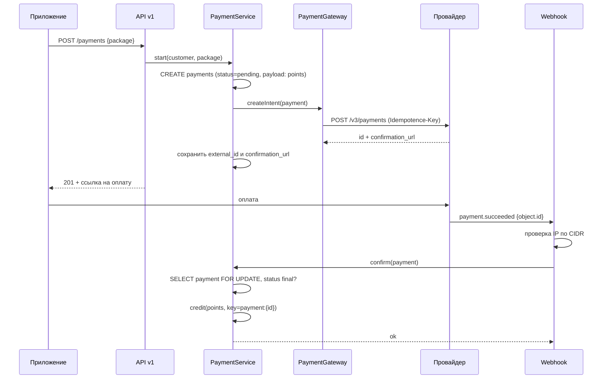

# Архитектура CIO Loyalty

## 1. Контекст

Digital-агентство ведёт несколько брендов. У каждого бренда — своё мобильное приложение (iOS/Android) и своя программа
лояльности. Серверная часть общая: один код, одна база, изоляция по бренду. Это снижает стоимость поддержки и позволяет
переиспользовать механику баллов, наград и платежей между клиентами агентства.

Участники системы:

| Участник | Взаимодействие |
| --- | --- |
| Мобильное приложение | REST API `/api/v1`, Bearer-токен Sanctum |
| Оператор бренда | Админ-панель `/admin`, сессионная авторизация, роль `manager` |
| Администратор агентства | Та же админка, роль `admin`, видит все бренды |
| Платёжный провайдер | Редирект на оплату + вебхук о результате |
| Push-сервис | Асинхронная отправка через очередь |

## 2. Слои

```
HTTP (контроллеры, form-request, ресурсы)
    ↓
Домен (сервисы: PointLedger, RedemptionService, PaymentService, TierCalculator)
    ↓
Данные (Eloquent-модели, миграции)
    ↓
Инфраструктура (Redis: кеш и очереди; шлюзы платежей и пушей)
```

Правила, которые соблюдаются в коде:

1. Контроллер не содержит бизнес-логики: валидация → вызов сервиса → ресурс.
2. Сервис не знает про HTTP: возвращает модели или бросает `DomainException` с HTTP-кодом внутри.
3. Любая операция с балансом проходит через `PointLedger` — прямых записей в `balance` нет.
4. Внешние системы спрятаны за интерфейсами (`PaymentGateway`, `PushGateway`) и подменяются в тестах.
5. Ответы API формируются ресурсами, а не «как получилось из модели».

## 3. Модель данных



Почему так:

- **`balance` и `lifetime_points` денормализованы.** Баланс нужен на каждом экране приложения; считать `SUM(points)`
  на лету по журналу дорого. Журнал — источник истины, баланс — кеш, оба меняются в одной транзакции.
- **`lifetime_points` отдельно от `balance`.** Уровень зависит от того, сколько клиент заработал за всё время,
  а не от текущего остатка: списание баллов не должно понижать статус.
- **`idempotency_key` с уникальным индексом.** Гарантия «одна операция — одно списание» держится на БД, а не на памяти
  процесса. Накладные расходы — один индекс.
- **`source_type`/`source_id`** связывают транзакцию с обменом или платежом: в поддержке видно, откуда взялись баллы.

## 4. Жизненный цикл запроса

### Обмен награды



Порядок блокировок фиксирован (награда → счёт), поэтому взаимные блокировки между параллельными обменами
не возникают: все запросы захватывают строки в одном порядке.

### Платёж и вебхук



Повторная доставка того же события ничего не меняет: `markSucceeded()` возвращает `false` для платежа
в финальном статусе, а начисление защищено ключом `payment:{id}`.

## 5. Кеш и очереди

| Что | Ключ / очередь | TTL / политика |
| --- | --- | --- |
| Каталог наград бренда | `brand:{id}:rewards:active` | 120 с + сброс при записи через админку |
| OTP-код | `otp:sha1(phone)` | 5 минут, удаляется после успешной проверки |
| Пуши после обмена | queue `default` | 3 попытки, backoff 10/60/180 с, `afterCommit` |
| Пересчёт уровней | `RecalculateTier` | еженедельно, `chunkById(500)` |
| Сгорание баллов | `loyalty:expire-points` | ежедневно 03:00, `withoutOverlapping()->onOneServer()` |

Кеш инвалидируется по точному ключу, без тегов: проект должен работать и на Redis, и на `database`-сторе,
чтобы локальная разработка не требовала Redis для старта.

## 6. Безопасность и разграничение доступа

- Токены Sanctum с областью `loyalty`; паролей у клиентов нет вообще — только OTP.
- `EnsureCustomerBrand` сверяет бренд токена с брендом запроса: перепутать заголовок и получить чужие данные нельзя.
- Админка — сессионная, `manager` ограничен своим брендом на уровне запросов (`where brand_id`) и на уровне
  отдельных ресурсов (`ensureAccessible`).
- Вебхук принимается только с адресов провайдера (`IpUtils::checkIp` по списку CIDR); список пуст — проверка
  отключена, что удобно локально и явно видно в конфиге.
- Лимиты: 60 запросов/мин на API, 5/мин на OTP, 20/мин на обмен, 120/мин на вебхуки.

## 7. Ошибки

Единая точка — `DomainException` (422/404/409/403/502) и его наследники. Исключение само умеет отрендериться
в JSON с машинным `code` и `context`, поэтому клиент показывает осмысленный текст, а поддержка видит причину:

```json
{
  "message": "Недостаточно баллов для операции.",
  "code": "InsufficientPointsException",
  "context": { "balance": 250, "required": 500, "missing": 250 }
}
```

Валидация остаётся за Laravel (422 + `errors`), непойманные ошибки — стандартный обработчик.

## 8. Что осознанно не сделано

| Решение | Причина | Как бы развивал |
| --- | --- | --- |
| Нет Horizon | Очередь на Redis уже работает; Horizon — операционный инструмент, тянет зависимость и дашборд | Подключить на этапе прод-эксплуатации, вместе с метриками очередей |
| Нет GraphQL | Мобильному клиенту хватает 8 эндпоинтов; GraphQL добавил бы слой без выгоды | Lighthouse, если появятся партнёрские интеграции с разными наборами полей |
| Нет Elasticsearch | Поиск по клиентам идёт по `phone`/`name` с индексами, объёмы демо-стенда малы | Полнотекстовый поиск по каталогу и истории при росте до сотен тысяч записей |
| OTP без SMS-провайдера | Демо не должно требовать боевых ключей | Абстракция `SmsSender` + провайдер (SMS.ru), как сделано с платежами |
| Нет GraphQL/OpenAPI-валидации в CI | Спека есть, автотест контракта — следующий шаг | Spectral или Dredd в CI |

## 9. Как масштабируется

- API и воркеры — stateless: сессии в cookie, кеш и очереди в Redis, состояние только в БД.
- Горячий путь обмена ограничен двумя строковыми блокировками; при росте нагрузки каталог читается из кеша,
  а запись — редкая операция.
- Тяжёлые операции (пересчёт уровней, сгорание баллов) вынесены в очередь и расписание, а не выполняются в запросе.
- Партиционирование журнала по месяцам — очевидный следующий шаг при миллионах операций.
